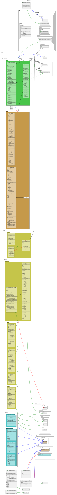

# ExamNotifications Plugin

ILIAS-Plugin für das Senden von Benachrichtigungen an Studierende während einer Prüfung

## Inhalt

[TOC]

---

## 1. Kompatibilität

Das Plugin wurde mit Version `9.14` getestet.

_[Inhaltsverzeichnis](#inhalt)_

---

## 2. Nutzen

Während einer Prüfung können die Prüfenden den Studierenden Nachrichten zukommen lassen.
Die Funktion muss dabei nicht über Drittprogramme wie zum Beispiel Zoom bereitgestellt werden; sie ist in ILIAS integriert. Für den Text der Nachricht stehen 200 Zeichen zur Verfügung. Zusätzlich wird der Name des Tests und die Uhrzeit ausgegeben, zu der die Nachricht festgelegt wurde.

Die Nachricht wird als andere Elemente überlagerndes Banner angezeigt, damit die Studierenden auf die Nachricht aufmerksam werden **oder** als *Toast* mit einer *Benachrichtigung* im ILIAS Benachrichtigungs-Center. Dabei sind beide Varianten weniger aufdringlich als ein modales Dialogfenster und können mit einem Klick geschlossen werden.

_[Inhaltsverzeichnis](#inhalt)_

----

## 3. Bedienung

### 3.1 Für den Prüfenden
Die Nachricht wird pro Testobjekt eingestellt, über einen Hauptmenüpunkt der nur innerhalb eines Testobjekts erschient, wenn Schreibrechte für das Testobjekt vorhanden sind. Es können mehrere Nachrichten zur gleichen Zeit aktiv sein. Sobald eine Nachricht eingestellt wurde, kann der Verlauf dort auch gelöscht oder exportiert werden.

---

### 3.2 Für die Studierenden
Die Nachricht wird in der Ansicht zur Bearbeitung einer Frage minütlich im Hintergrund abgefragt. Falls eine Nachricht eingestellt wurde, wird diese für alle angezeigt, die einen Testlauf begonnen haben und noch nicht abgeschlossen haben. Die Nachricht kann vom Studierenden über das **x** geschlossen werden und wird **nicht** mehr angezeigt.

_[Inhaltsverzeichnis](#inhalt)_

----

## 4. Installation / Update

### 4.1 Installation

Ausgehend vom ILIAS-Verzeichnis

```bash
mkdir -p Customizing/global/plugins/Services/UIComponent/UserInterfaceHook
cd Customizing/global/plugins/Services/UIComponent/UserInterfaceHook
git clone -b ILIAS_9.0.0 https://gitlab.fh-bielefeld.de/ilias/ExamNotifications.git ExamNotifications
cd ExamNotifications
git checkout v9.0.0.1
git submodule update --init --recursive *
# Zurück ins ILIAS-Verzeichnis:
cd ../../../../../../../
sudo -uwww-data composer du
```

### 4.2 Update

Das Plugin in der ILIAS Plugin-Administration *deaktivieren*.

Ausgehend vom ILIAS-Verzeichnis:

```bash
cd Customizing/global/plugins/Services/UIComponent/UserInterfaceHook/ExamNotifications
git pull
git checkout v9.0.0.1
# Löscht ggf. nicht mehr benötigte aber noch vorhandene Submodule, die nicht mehr durch git getrackt werden und somit verwaist sind
git clean -ffd *
git submodule update --init --recursive *
# Zurück ins ILIAS-Verzeichnis:
cd ../../../../../../../
sudo -uwww-data composer du
```

Das Plugin in der ILIAS Plugin-Administration *updaten* und wieder *aktivieren*.

_[Inhaltsverzeichnis](#inhalt)_

----

## 5. Konfiguration

### 5.1 Einbindungsart

In der Plugin-Konfiguration kann zwischen folgenden Einbindungsarten der Benachrichtigungen gewählt werden:

- Globalscreen Toast + Notification
- Als ein mit JavaScript eingebettetes rotes Banner

_[Inhaltsverzeichnis](#inhalt)_

-----

## 6. Submodule

| Name                  | Version    | Lokaler Einbindungspfad                                      | URL                                                          |
| --------------------- | ---------- | ------------------------------------------------------------ | ------------------------------------------------------------ |
| plugin-core-functions | `v9.0.0.2` | [`vendor/submodules/plugin-core-functions`](vendor/submodules/plugin-core-functions) | https://gitlab.fh-bielefeld.de/ilias/plugin-core-functions/-/tree/v9.0.0.2?ref_type=tags |

_[Inhaltsverzeichnis](#inhalt)_

-----
## 7. Branches

Eine neue Branch wird immer dann angelegt, wenn das Plugin aufgrund von Änderungen am ILIAS-Code nicht mehr funktioniert. Die Branch heißt dann wie die ILIAS-Version, die die Änderungen verursacht. Z.B.: `ILIAS_9.6.0`

_[Inhaltsverzeichnis](#inhalt)_

-----

## 8. Tags / Versionierung

Ein neuer Tag wird dann gesetzt, wenn das Plugin eine neue Funktion/Bug-Fix hinzugefügt wurde oder wenn das Plugin an eine neue ILIAS-Version angepasst wurde. 

### 8.1 Aufbau Versions Nummerierung

Die ersten 3 Zahlen geben die minimale ILIAS Version an mit der das Plugin funktioniert und die letzte Zahl gibt die  Plugin Version für diese ILIAS Version an. Beispiel:

Ausgangs Tag/Version: `v9.0.0.4`

ILIAS-Version: `9.0.0`

Plugin-Version für ILIAS-Version (`9.0.0`): `4`

Da ILIAS nur 3-teiligen Versionen unterstützt, wird in der [plugin.php](plugin.php)-Version die letzten drei Stellen des 3. Teils als  Plugin-Version verwendet: `9.0.0004`

### 8.2 Neue Funktion/Bug-Fix

#### 8.2.1 Tags/Versionen für eine bestimmte ILIAS-Version vorhanden

Wird eine neue Funktion/Bug-Fix für eine bestimmte ILIAS-Version hinzugefügt, wird die letzte Zahl der letzten Version erhöht. Beispiel:

ILIAS-Version: `9.0.0`

Letzter Tag/Version für ILIAS-Version (`9.0.0`): `v9.0.0.4`

Neuer Tag/Version: `v9.0.0.5`

Neue [plugin.php](plugin.php)-Version: `9.0.0005`

#### 8.2.2 Tags/Versionen für eine bestimmte ILIAS-Version nicht vorhanden

Ist noch kein Tag/Version für eine ILIAS-Version vorhanden, ist die letzte Zahl der Version `0`. Beispiel:

ILIAS-Version: `9.0.1`

Letzter Tag/Version für ILIAS-Version (`9.0.1`): `nicht vorhanden`

Neuer Tag/Version: `v9.0.1.0`

Neue [plugin.php](plugin.php)-Version: `9.0.1000`

### 8.3 Anpassung an eine neue ILIAS-Version

Da noch kein Tag/Version für eine neue ILIAS-Version vorhanden sein kann, ist die letzte Zahl der Version `0`. Beispiel:

ILIAS-Version: `9.2.1`

Neuer Tag/Version: `v9.2.1.0`

Neue [plugin.php](plugin.php)-Version: `9.2.1000`

_[Inhaltsverzeichnis](#inhalt)_

-----

## 9. Quellcode Dokumentation

### 9.1 Mit PHP-Documentor generierte Dokumentation

[doc/api/index.html](doc/api/index.html)

### 9.2 UML Klassendiagramm



_[Inhaltsverzeichnis](#inhalt)_
